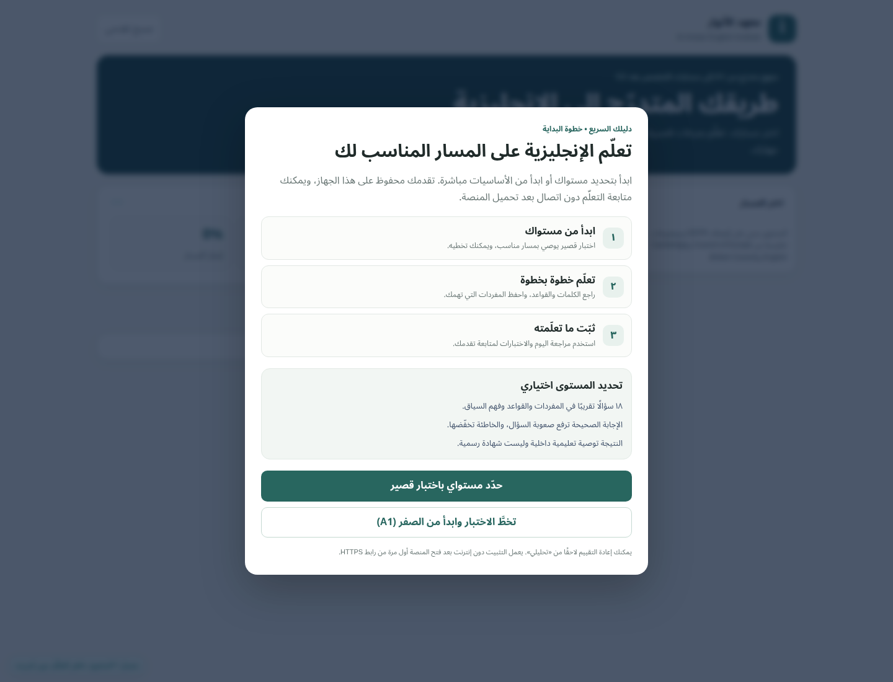
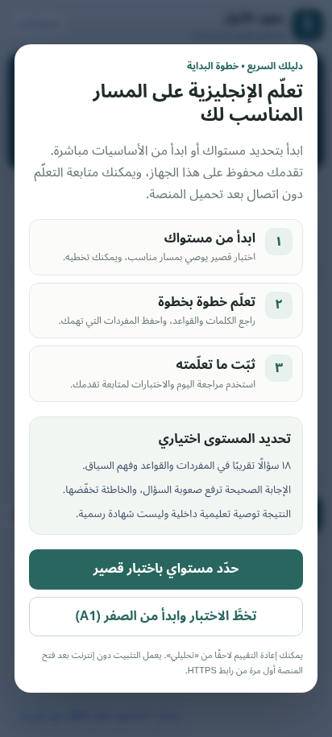
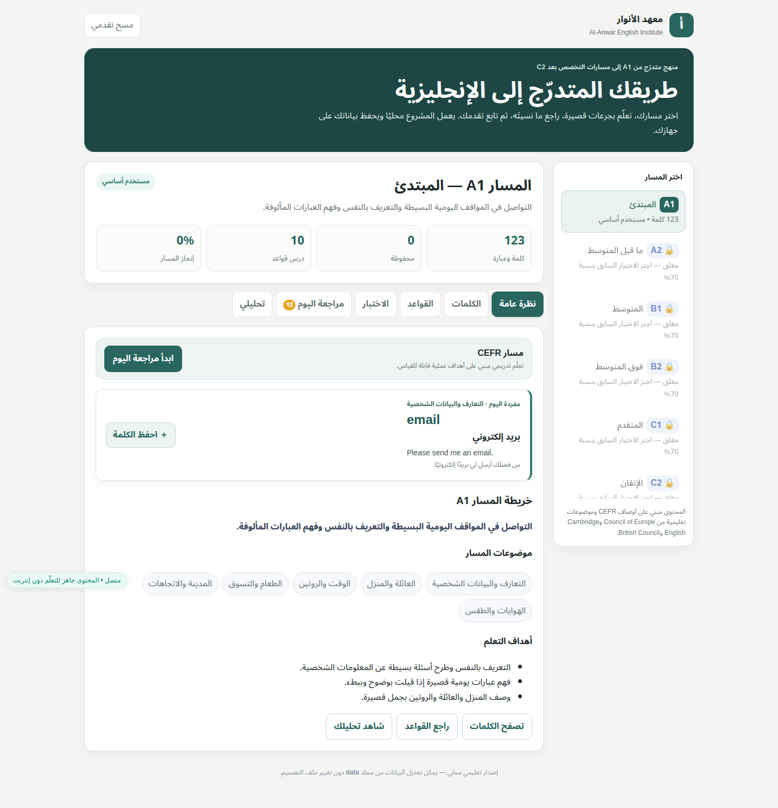

<div dir="rtl" align="right">

# معهد الأنوار لتعلّم اللغة الإنجليزية

**مساحة تعلم عربية عملية تساعد الطالب على معرفة نقطة بدايته، والتدرّج في الإنجليزية، ومراجعة ما تعلمه — حتى عند انقطاع الإنترنت بعد التثبيت والتهيئة الأولى.**

[افتح التطبيق مباشرةً](https://aladrisiaymenan-eng.github.io/al-anwar-english-learning-pwa/) · [طريقة التثبيت على Android](PWA_INSTALL.md) · [دليل الاستخدام](docs/دليل-الاستخدام.md) · [شرح بنية المشروع](docs/نظرة-تقنية.md) · [الوصف الاحترافي](docs/وصف-المشروع.md) · [الوصف الاحترافي](docs/وصف-المشروع.md)

> يفتح الرابط التطبيق على الويب الآمن HTTPS. على Android افتحه في Chrome ثم اختر **تثبيت التطبيق** أو **إضافة إلى الشاشة الرئيسية**. لا يوجد ملف APK؛ التثبيت يتم من المتصفح بصفته تطبيق PWA.

</div>

## لقطات من التطبيق

<div dir="rtl" align="center">

| شاشة البداية والإرشاد | واجهة التعلم على الهاتف |
|---|---|
|  |  |

</div>



*واجهة المسار بعد دخول الطالب إلى مستوى A1.*

## عن المشروع

معهد الأنوار تطبيق ويب تقدمي **PWA** عربي الواجهة لتعلّم الإنجليزية، مبني بملفات HTML وCSS وJavaScript وبيانات محلية. يقدّم مسارات من **A1 إلى C2**، تسبقها تجربة إرشادية واختبار تحديد مستوى اختياري، ويتيح للمبتدئ تجاوز الاختبار والبدء من A1. بعد التهيئة الأولى عبر HTTPS يمكن تثبيته على Android واستخدام المحتوى الأساسي دون اتصال.

صُمم للمتعلمين الذين يريدون طريقًا واضحًا ومريحًا: يعرف الطالب ما الذي يبدأ به، يدرس الكلمات والقواعد، يتدرّب في نهاية المسار، ثم ينتقل تدريجيًا وفق نتيجته. لا يتطلب المشروع حسابًا أو خادمًا؛ تقدم المتعلم محفوظ محليًا في متصفح ذلك الجهاز.

## أبرز المزايا

- اختبار تحديد مستوى تشخيصي عند البداية مع تقييم ذاتي، وخيار تخطيه والبدء من A1.
- تسعة مسارات: A1 وA2 وB1 وB2 وC1 وC2، ثم X1 وX2 وX3 كمسارات إثرائية بعد C2 وليست مستويات CEFR رسمية.
- مفردات بترجمة عربية وأمثلة سياقية، مع مرشحات للبحث والحفظ، ونطق يعتمد على محرك الجهاز.
- دروس قواعد قصيرة تشمل الشرح وطريقة التطبيق والمثال والخطأ الشائع والتدريب.
- اختبارات ختامية مع تصحيح وشرح، وفتح متدرج للمسارات وفق إتقان المسار السابق.
- «مفردة اليوم» و«مراجعة اليوم» للاسترجاع النشط، مع لوحة تحليلات شخصية محلية.
- تطبيق PWA قابل للتثبيت، ورسالة توضح حالة الاتصال وجهوزية ملفات التعلم دون إنترنت.
- واجهة عربية RTL متجاوبة مع الهاتف والكمبيوتر، ومساحات لمس أوضح وإرشاد عند أول استخدام.

## صور التوثيق

الصور أعلاه لقطات مباشرة للواجهة أثناء تشغيل المشروع. مزيد من الصور في مجلد [`screenshots`](screenshots/).

## التشغيل والتثبيت

### للطلاب — تثبيت التطبيق

1. افتح [رابط التطبيق](https://aladrisiaymenan-eng.github.io/al-anwar-english-learning-pwa/) على هاتف Android باستخدام Chrome.
2. انتظر ظهور رسالة **«متصل • المحتوى جاهز للتعلّم دون إنترنت»**. لا تغلق الصفحة قبل اكتمال تجهيز الملفات.
3. اضغط زر **ثبّت التطبيق** إن ظهر، أو افتح قائمة Chrome واختر **تثبيت التطبيق / إضافة إلى الشاشة الرئيسية**.
4. افتح التطبيق المثبّت مرة أخرى مع الإنترنت حتى يكتمل تحميل المحتوى، ثم اختبره بوضع الطيران.

على iPhone/iPad يمكن فتح الرابط في Safari ثم استخدام **مشاركة → إضافة إلى الشاشة الرئيسية**. تفاصيل المتطلبات والاستكشاف موجودة في [PWA_INSTALL.md](PWA_INSTALL.md).

### للمطورين — تشغيل محلي

يمكن فتح `index.html` للمعاينة، لكن ميزات PWA والعمل دون اتصال تتطلب HTTPS أو خادم تطوير محلي. مثال سريع:

```bash
python3 -m http.server 8000
```

بعدها افتح `http://localhost:8000`. لا يحتاج المشروع إلى تثبيت حزم أو خطوة build. للنشر على GitHub Pages، اختير جذر المستودع مصدرًا للنشر.

## بنية الملفات

```text
index.html                  واجهة التطبيق والمنطق التفاعلي
manifest.webmanifest        اسم التطبيق وأيقوناته وسلوك فتحه
pwa.js                      تثبيت PWA ورسائل الاتصال وتسجيل Service Worker
service-worker.js           تخزين الملفات المطلوبة للاستخدام دون اتصال
data/curriculum.json        المصدر المنظم لبيانات المسارات
data/curriculum.js          نسخة التشغيل للبيانات الأساسية
data/courses/{LEVEL}.json   بيانات كل مسار مستقلة
data/courses/{LEVEL}.js     نسخ التشغيل للمسارات
data/placement_test.*       بيانات اختبار تحديد المستوى
icons/                      أيقونات التطبيق 192 و512 بكسل
screenshots/                 صور توثيق الواجهات
docs/                       دليل الاستخدام والشرح التقني
tools/sync_data.py           مزامنة/توليد ملفات البيانات
PWA_INSTALL.md               تعليمات التثبيت والعمل دون اتصال
```

## الخصوصية وحدود العمل دون اتصال

لا يجمع التطبيق بيانات الطالب في خادم ولا ينشئ حسابًا. تُحفظ التفضيلات والتقدم ونتائج التقييم محليًا في مساحة المتصفح على الجهاز، ولذلك لا تنتقل تلقائيًا إلى جهاز آخر وقد تُحذف عند مسح بيانات الموقع. يلزم اتصال بالإنترنت في الزيارة الأولى لتنزيل ملفات التطبيق. يعتمد النطق على أصوات النظام؛ قد يلزم تنزيل صوت English إلى الهاتف مسبقًا كي يعمل النطق دون اتصال.

اختبار تحديد المستوى أداة توجيه تعليمية داخلية، وليس اختبارًا رسميًا أو شهادة معتمدة. مستويات CEFR المعروفة هنا هي A1–C2؛ أما X1–X3 فمسارات إثرائية خاصة بالمشروع.

## التوثيق والتنفيذ

- [دليل الاستخدام للطلاب](docs/دليل-الاستخدام.md)
- [النظرة التقنية وسير العمل](docs/نظرة-تقنية.md)
- [وصف المشروع الاحترافي](docs/وصف-المشروع.md)
- [تعليمات تثبيت PWA](PWA_INSTALL.md)
- [مراجعة المشروع والتحسينات](مراجعة_المشروع_وتحسيناته.md)

## الملكية والمساهمة

هذا مستودع عام للاطلاع والتنزيل. لم يُرفق ترخيص مفتوح؛ لذلك لا يعني إتاحته للعامة التنازل عن حقوق المحتوى أو منح حق إعادة الاستخدام التجاري.
